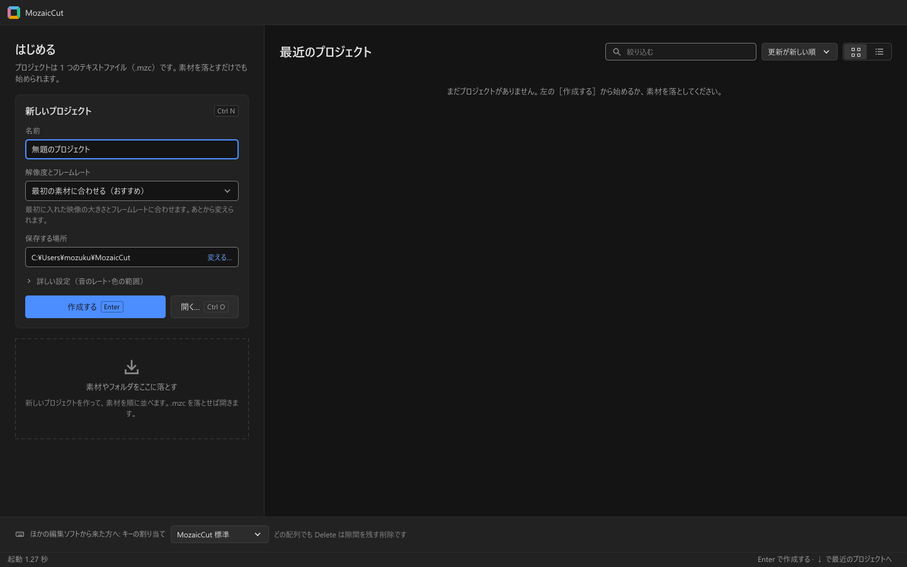
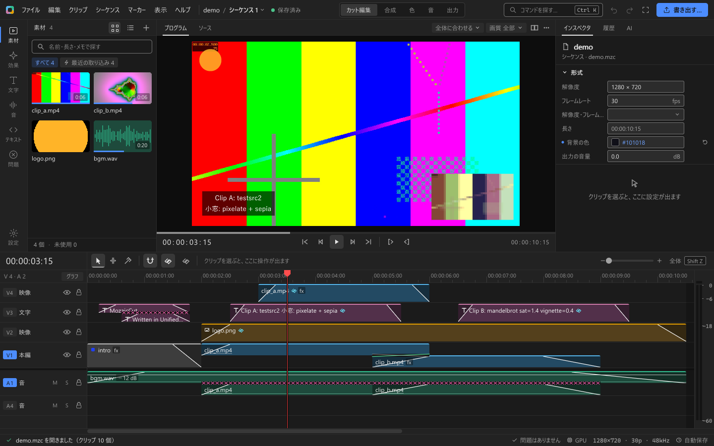
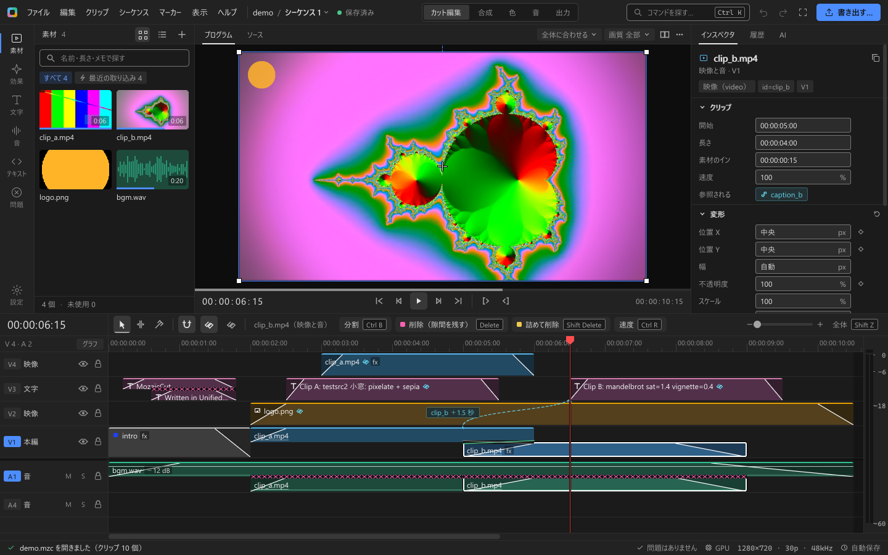
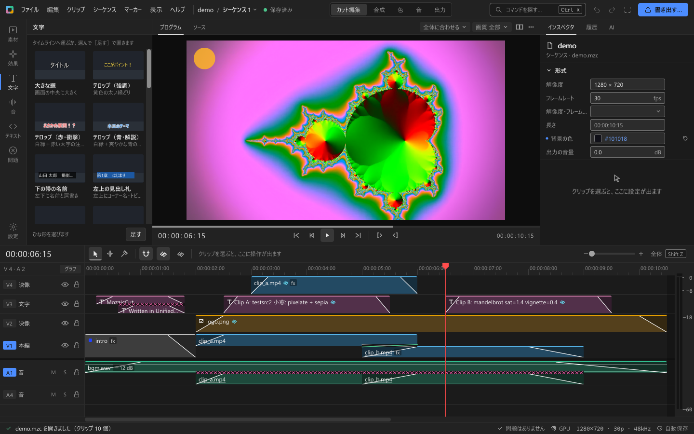
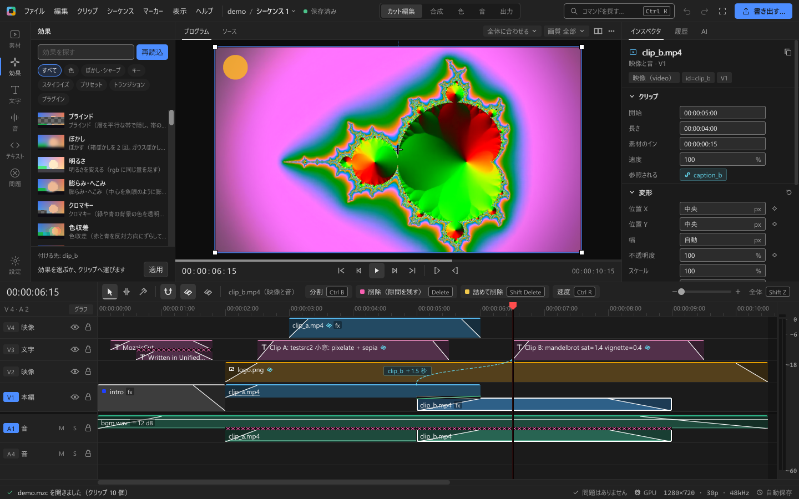
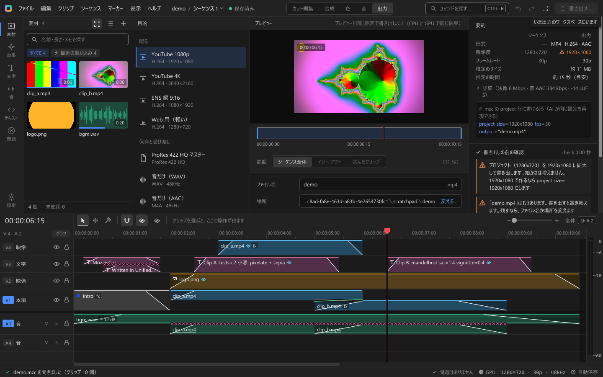

# 0. はじめての人へ — 10 分で 1 本の動画を作る

[目次](README.md) ／ 次: [1. はじめに](01-getting-started.md)

この章は、**動画編集をしたことがない人**のための手引きです。コマンドやテキストのファイルのことは知らなくてかまいません。マウスとキーボードだけで、次の流れを 1 回通します。

1. MozaicCut を起動する
2. 新しいプロジェクトを作り、素材（動画・写真・音楽）を入れる
3. タイムラインに並べる
4. 要らない所を切って消す
5. 文字（タイトル）を入れる
6. 効果とつなぎ（トランジション）を付ける
7. 動画のファイル（MP4）に書き出す

> **こわがらなくて大丈夫です。** どの操作も **Ctrl+Z** で取り消せます（やり直しは Ctrl+Shift+Z）。それに、元の動画や写真のファイルは MozaicCut がどんな操作をしても書き換えません。

---

## 0.1 ことばの意味

最初に、この説明書でよく出ることばを覚えておくと楽です。

| ことば | 意味 |
| --- | --- |
| **素材** | 編集に使う元のファイル。動画（.mp4 など）、写真（.png / .jpg）、音（.wav / .mp3 など） |
| **プロジェクト** | 編集の中身を書いたファイル（`.mzc`）。素材そのものは入っておらず、「どの素材のどこを、いつ映すか」だけが書いてある |
| **タイムライン** | 画面の下の、横に長い帯の並び。左から右へ時間が進む |
| **クリップ** | タイムラインに置いた 1 つの素材（の一部）。色のついた横長の箱 |
| **トラック** | タイムラインの 1 段。上の段の映像ほど手前に重なる |
| **再生ヘッド** | タイムラインを縦に走る赤い線。いま見ている時刻 |
| **書き出し** | 編集した結果を、だれでも見られる 1 本の動画ファイル（MP4）にすること |

---

## 0.2 起動する

配布の zip（Windows は `MozaicCut-windows-x64.zip`、Mac は `MozaicCut-macos-arm64.zip`）を展開し、中の **MozaicCut.exe**（Mac は **MozaicCut.app**）をダブルクリックします。ほかに入れるものはありません。

起動すると、**スタート画面**が出ます。

- 左の「新しいプロジェクト」で、新しく作ります。
- 右の「最近のプロジェクト」に、前に開いたものが並びます。押せば続きから編集できます。
- 下の「キーの割り当て」は、ほかの編集ソフト（Premiere や DaVinci Resolve）に慣れている人だけ変えてください。はじめての人は **MozaicCut 標準** のままで大丈夫です。

> 開発用のフォルダから使う人は、`node tools/mozcut.mjs edit` で同じスタート画面が開きます（準備は [1. はじめに](01-getting-started.md)）。

---

## 0.3 新しいプロジェクトを作る

1. 「名前」に、動画の名前を入れます（例: `旅行の思い出`）。
2. 「解像度とフレームレート」は **最初の素材に合わせる（おすすめ）** のままにします。最初に入れた動画と同じ大きさになります。
3. 「保存する場所」の［変える…］で、プロジェクトを置くフォルダを選びます。素材と同じフォルダにしておくと、あとで迷いません。
4. ［**作成する**］を押します（Enter でも同じ）。

いちばん早いのは、**素材のファイルを、エクスプローラー（Mac は Finder）から、スタート画面の点線の枠に落とす**ことです。新しいプロジェクトができて、落とした素材が順に並んだ状態で始まります。

> **保存は自動です。** 編集するたびに、プロジェクトのファイル（`.mzc`）に書き込みます。画面の右下に「自動保存」と出ていれば大丈夫です。Ctrl+S を押しても構いません。

---

## 0.4 編集画面の見方

プロジェクトを開くと、編集画面になります。次の絵は、見本のプロジェクト（`demo/demo.mzc`）を開いたところです。

画面は大きく 5 つに分かれています。

| 場所 | 名前 | すること |
| --- | --- | --- |
| 左上 | **素材の欄** | 入れた素材の一覧。ここからタイムラインへ運ぶ |
| 左端の縦の列 | **レール** | 素材・効果・文字・音などの欄を切り替えるボタン |
| 真ん中の上 | **モニター（プログラム）** | 再生ヘッドの時刻の絵。できあがりの見た目 |
| 右上 | **インスペクタ** | 選んだクリップの設定（位置・大きさ・文字・効果の強さなど） |
| 下半分 | **タイムライン** | クリップを並べる所 |

上の帯の真ん中にある［カット編集］［合成］［色］［音］［出力］は、**ワークスペース**（作業ごとの画面の並び）の切り替えです。はじめのうちは［**カット編集**］だけで足ります。書き出すときだけ［出力］を使います。

### 見る・動かす

| したいこと | 操作 |
| --- | --- |
| 再生する ／ 止める | **Space** |
| 好きな時刻へ飛ぶ | タイムラインの上の目盛りをクリック（ドラッグでなぞると絵が動く） |
| 1 コマ進む ／ 戻る | → ／ ← |
| 先頭 ／ 末尾へ | Home ／ End |
| タイムラインを広げる ／ 縮める | = ／ - （全体を見るのは Shift+Z） |

---

## 0.5 素材を入れて、並べる

1. 素材の欄の右上の［**＋**］を押すか、**Ctrl+I** を押して、素材のファイルを選びます。ファイルを素材の欄に落としても入ります。
2. 素材の欄に、縮小した絵（音なら波形）が並びます。
3. 使いたい素材を、**素材の欄からタイムラインへドラッグ**して、置きたい時刻で離します。

並べ方のこつ:

- **映像**は「本編」（V1）の段に左から順に置きます。前のクリップの終わりに近づけると、ぴたりとくっつきます（スナップ）。
- **BGM などの音楽**は、下の「音」（A1）の段に置きます。
- **ロゴや写真を重ねたい**ときは、本編より上の段（V2 など）に置きます。上の段ほど手前に映ります。
- 置いたクリップは、**ドラッグで動かせます**。クリップの左右の端をドラッグすると、使う範囲を短く・長くできます。

---

## 0.6 切る・消す

撮った動画の「要らない所」を消すのが、編集のいちばん基本の作業です。

1. 消したい所の**始まり**に再生ヘッドを合わせます（目盛りをクリック、細かくは ← →）。
2. タイムラインでクリップを押して選び、**Ctrl+B**（分割）を押します。クリップが 2 つに分かれます。
3. 消したい所の**終わり**でも、同じように Ctrl+B を押します。
4. 間にできた要らないクリップを選び、
   - **Shift+Delete** … 消して、後ろを前に詰める（ふつうはこれ）
   - **Delete** … 消して、隙間を残す

クリップを選ぶと、タイムラインの上の帯に［分割］［削除（隙間を残す）］［詰めて削除］のボタンが出ます。キーを覚えていなくても、ここを押せば同じことができます。

> **まちがえたら Ctrl+Z。** 何回でも戻れます。右上の［履歴］を開くと、これまでの操作の一覧から好きな所まで戻せます。

---

## 0.7 文字（タイトル・テロップ）を入れる

1. 文字を出したい時刻に再生ヘッドを合わせます。
2. 左のレールの［**文字**］を押します。文字のひな形が並びます。
3. 使いたいひな形（「大きな題」「テロップ（強調）」「下の帯の名前」など）を選んで［**足す**］を押します。タイムラインの空いている段へ、ひな形をドラッグしても置けます。
4. 置いた文字のクリップを選ぶと、右のインスペクタに「文字」の欄が出ます。**中身・大きさ・色・書体**をここで変えます。
5. 文字を出しておく長さは、クリップの右の端をドラッグして変えます。

**字幕**をすばやく入れたいときは **Shift+T** です（再生ヘッドの時刻に、画面の下に出る字幕を足します）。

---

## 0.8 効果とトランジションを付ける

### 効果（色を変える・ぼかす・モザイク など）

1. 効果を付けたいクリップをタイムラインで選びます。
2. 左のレールの［**効果**］を押します。
3. 一覧から効果を選んで［**適用**］を押します（効果をクリップの上へドラッグしても付きます）。上の「色」「ぼかし・シャープ」「スタイライズ」「プリセット」などで種類を絞れ、「効果を探す」に名前を入れて探すこともできます。
4. **強さ**は、右のインスペクタの効果の欄で変えます。

> **顔や車のナンバーを隠したい**ときは「モザイク」か「ぼかし」です。決まった色の組み合わせを一度に付ける「プリセット」（映画風・レトロなど）も試してみてください。

効果を付けたクリップには、タイムラインで小さな「fx」の印が付きます。効果をやめたいときは、インスペクタの効果の見出しのチェックを外します（付けた直後なら Ctrl+Z でも戻せます）。見出しの ↺ を押すと、強さなどを最初の値に戻します。

### トランジション（場面のつなぎ）

前のクリップから次のクリップへ、ふわっと切り替えたいとき:

1. 後ろ側のクリップを選び、**Ctrl+D** を押します（メニューの［クリップ］→［トランジションを付ける］でも同じ）。前のクリップとくっついていれば、2 つが重なりながら切り替わります（クロスフェード）。前に何もなければ、ふわっと出入りします（フェード）。
2. つなぎの種類（黒にフェード・ワイプ・ズームなど）を変えたいときは、［効果］の欄の［**トランジション**］の種類から選びます。

---

## 0.9 書き出す（MP4 を作る）

1. 右上の青い［**書き出す…**］を押します（Ctrl+M でも同じ）。［出力］のワークスペースに変わります。
2. 左の「目的」から、使い道を選びます。迷ったら次のとおりです。

   | 使い道 | 選ぶもの |
   | --- | --- |
   | YouTube やパソコンで見る | **YouTube 1080p** |
   | スマホの縦の動画（ショート・リール） | **SNS 縦 9:16** |
   | メールやチャットで送る（軽くしたい） | **Web 用（軽い）** |
   | 音だけ取り出す | **音だけ（WAV）** か **音だけ（AAC）** |

3. 真ん中の「ファイル名」と「場所」を確かめます（［変える…］で場所を選べます）。
4. 右の「書き出しの前の確認」に注意（⚠）が出ていたら、読んでおきます。たとえば「同じ名前のファイルがあるので置き換えます」と出ていれば、名前を変えると元のファイルが残ります。
5. ［**書き出す**］を押します。終わると、選んだ場所に MP4 ができます。

全体ではなく一部だけ書き出したいときは、「範囲」で［イン〜アウト］（I と O のキーで付けた範囲）か［選んだクリップ］を選びます。

---

## 0.10 困ったとき

| こんなとき | こうする |
| --- | --- |
| まちがえた | **Ctrl+Z**（何回でも）。戻しすぎたら Ctrl+Shift+Z |
| 画面の並びがくずれた | メニューの［表示］→［配置を既定に戻す］ |
| キーを忘れた | **F1** でキーの一覧。メニューの［ヘルプ］→［使い方の説明］もあります |
| やりたいことのボタンが見つからない | 右上の「コマンドを探す…」（**Ctrl+K**）に、やりたいことを入れる（例: 「分割」「書き出し」「字幕」） |
| 素材が「見つからない」と出る | 素材のファイルを動かしたか、名前を変えた。元の場所に戻すか、書き出しの画面の確認から場所を指定し直す |
| 左下の「問題」に数字が出ている | レールの［問題］を押すと、何がおかしいかと直し方が出ます。詳しくは [7. 困ったとき](07-troubleshooting.md) |
| 動作が重い | モニターの右上の「画質」を下げると、再生が軽くなります（書き出す動画の画質は変わりません） |

---

## 0.11 次に読むもの

この章で、1 本の動画を作る流れはひととおりです。慣れてきたら、次の章へ進んでください。

- もっと細かい編集（範囲の切り取り、キーの一覧）… [2. 編集の基本](02-editing.md)
- 文字の表現をもっと凝る … [3. テキストで編集する](03-text.md)
- 効果の一覧と、画面全体に掛ける効果 … [4. 効果を掛ける](04-effects.md)
- 書き出しの細かい設定 … [5. 書き出す](05-export.md)
- AI に編集を手伝ってもらう … [6. AI と一緒に使う](06-ai.md)
