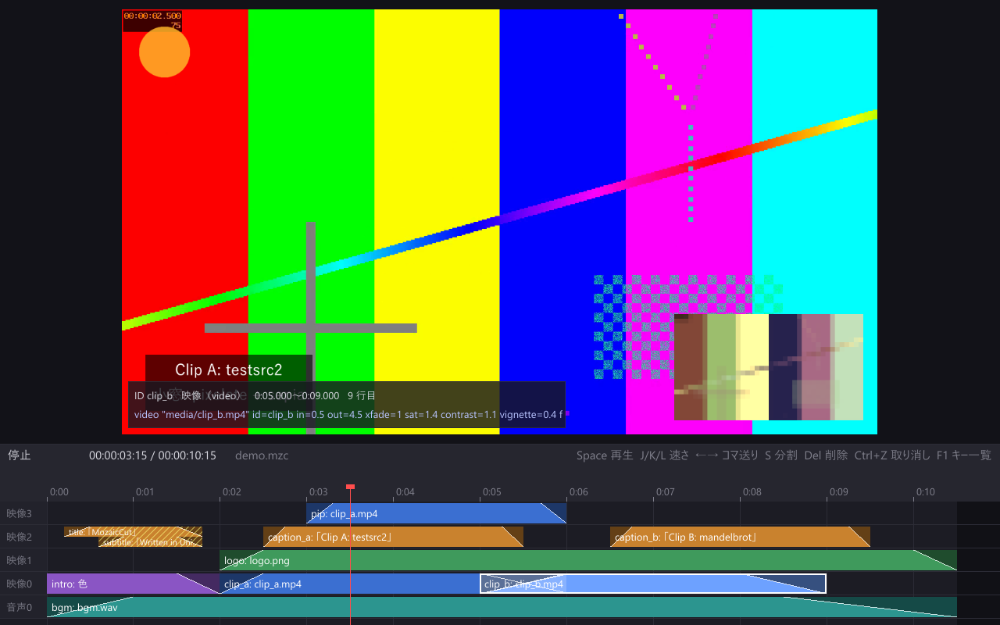

# 1. はじめに

[目次](README.md) ／ 次: [2. 編集の基本](02-editing.md)

## 1.1 必要なもの

| もの | 何に使うか | 入れ方・場所の伝え方 |
| --- | --- | --- |
| Node.js 22.18 以上 | コマンド（`tools/mozcut.mjs`）を動かす | PATH に置く |
| [UnifiedMozaic](../../../UnifiedMozaic)（UM）と clang | MozaicCut のエンジンと編集画面を作る | MozaicCut の隣のフォルダに置くか、環境変数 `UM_HOME` |
| ffmpeg と ffprobe | 素材を読む・動画に書き出す | PATH に置くか、環境変数 `FFMPEG` / `FFPROBE` |
| SDL3（3.2.12 以上） | 編集画面（ウィンドウ）だけに使う | Windows は `SDL3-devel-*-VC.zip` を展開して `UM_SDL3`（なければ隣とホームフォルダの `SDL3-*` を探す）。macOS は `brew install sdl3` |
| TrueType のフォント | 文字を描く | 指定しなければ、游ゴシック Medium → BIZ UDゴシック → メイリオ → Arial Unicode → IPAex ゴシック → DejaVu Sans の順に探す |

コマンドだけで編集・書き出しをするなら、SDL3 はなくても動きます。

## 1.2 はじめての起動

MozaicCut のフォルダで、次を順に実行します。

```sh
node tools/demo-media.mjs              # デモの素材を作る（初回だけ。ffmpeg を使う）
node tools/mozcut.mjs check demo/demo.mzc
```

初回は、エンジン（`build/mozcut`）を自動でビルドします（数十秒かかります）。終わると次のように出ます。

```console
$ mozcut check demo/demo.mzc
問題はありません（クリップ 10 個、長さ 0:10.500）
```

エンジンと編集画面を明示的に作り直すときは `mozcut build` です。`src/` や `plugins/` を書き換えたときは、次の実行で自動で作り直します。

使えるコマンドの一覧は `mozcut help` で出ます。

```console
$ mozcut help
使い方: node tools/mozcut.mjs <コマンド> ...

  edit    [<project.mzc>]                       編集画面を開く（ウィンドウ。SDL3 が要る。省くとスタート画面）
  render  <project.mzc> [-o out.mp4] [--from t] [--to t] [-j N]
                                                動画を書き出す（既定は project の output）
  preview <project.mzc> <time> [-o preview.png] 1 コマを画像に書く
  check   <project.mzc> [--json]                誤りを調べる（誤りなし 0、誤りあり 1）
  show    <project.mzc> [--width N]             タイムラインの図とクリップの一覧
  op      <project.mzc> <操作...> [--dry-run] [--json]
  op      <project.mzc> --file <ops.txt | -> [--dry-run] [--json]
                                                操作を適用して保存する。--file はファイル（- なら標準入力）の 1 行に 1 つ
  schema  [--json]                              キー・効果・操作・時刻と参照の書き方の一覧
  build                                         エンジンと編集画面を作り直す
  plugin build <名前 | file.um> [-o out.mzplug] 効果のプラグインを wasm（dist/<名前>.mzplug）にする
  plugin list [--json]                          組み込みの効果と、入れた .mzplug の一覧
  plugin install <file.mzplug>                  .mzplug を plugins-installed/ に入れる
  plugin uninstall <名前>                       入れた .mzplug を外す

op の書き方: node tools/mozcut.mjs schema
```

## 1.3 スタート画面

プロジェクトを渡さずに編集画面を起動すると、スタート画面が開きます。

```sh
mozcut edit
```

- **はじめる**: 「デモを開く」（MozaicCut のフォルダの `demo/demo.mzc`）。
- **最近開いたプロジェクト**: 編集画面で開いたプロジェクトが、新しい順に最大 10 件並びます。
- 操作: ↑↓ で選ぶ、Enter かクリックで開く、Del で一覧から外す（ファイルは消しません）、Esc で終わる。

スタート画面から開いたときは、**素材を展開しません**（展開済みのキャッシュ `<名前>.cache/` があればそれを使います）。展開されていない素材は、画面に「`node tools/mozcut.mjs edit <project>` で開くと展開します」と案内が出ます。はじめて開くプロジェクトは、次の「端末から開く」で開いてください。

準備中: 新しいプロジェクトを作るカード、素材のドロップ、「開く…」（Ctrl+O）のダイアログ、縮小画像つきの最近のプロジェクト、検索と並べ替え。

## 1.4 プロジェクトを開く

```sh
mozcut edit demo/demo.mzc
```

素材を ffmpeg で展開してから（2 回目からはキャッシュを使います）、編集画面が開きます。上がプレビュー、下がタイムラインです。



- 画面を開いている間、`mozcut edit` は `.mzc` を見張り、書き換わるたびに必要な素材だけを展開し直します。テキストエディタで `.mzc` を書き換えて保存しても、画面はすぐに読み直します。
- 閉じるのは Ctrl+Q か Ctrl+W です。

コマンドだけで中身を見るなら `show` です。

```console
$ mozcut show demo/demo.mzc --width 90
demo.mzc
1280x720  30fps  48000Hz  0:10.500  クリップ 10
    0:00    0:01    0:02    0:03    0:04    0:05     0:06    0:07    0:08    0:09    0:10
    +-------+-------+-------+-------+-------+--------+-------+-------+-------+-------+----
V3                          [pip                    ]
V2   [title      ]      [caption_a              ]        [caption_b             ]
        [subtitle]
V1                  [logo                                                                ]
V0  [intro         ][clip_a                         ]
                                            [clip_b                         ]
A0  [bgm                                                                                 ]

 #  ID         行  種類   トラック      開始    終わり  素材 / 文字                               効果
#0  intro       7  color  V0        0:00.000  0:02.000  202040                                    vignette=0.7
#1  clip_a      8  video  V0        0:02.000  0:06.000  media/clip_a.mp4                          -
#2  clip_b      9  video  V0        0:05.000  0:09.000  media/clip_b.mp4                          sat=1.4 contrast=1.1 vignette=0.4
#3  pip        12  video  V3        0:03.000  0:06.000  media/clip_a.mp4                          pixelate=8 sepia=0.8
#4  logo       15  image  V1        0:02.000  0:10.500  media/logo.png                            -
#5  title      18  text   V2        0:00.200  0:01.800  "MozaicCut"                               -
#6  subtitle   19  text   V2        0:00.600  0:01.800  "Written in UnifiedMozaic"                -
#7  caption_a  20  text   V2        0:02.500  0:05.500  "Clip A: testsrc2\n小窓: pixelate + ..."  -
#8  caption_b  21  text   V2        0:06.500  0:09.500  "Clip B: mandelbrot\nsat=1.4 vignett..."  -
#9  bgm        24  audio  A0        0:00.000  0:10.500  media/bgm.wav                             -
```

`V` は映像のトラック（番号が大きいほど手前に描く）、`A` は音のトラックです。左の `#0`、`#1` … と `ID`、`行` は、操作でクリップを指すときに使います（[2.2](02-editing.md#22-クリップの指し方)）。

## 1.5 プロジェクトを作る

いまの版には「新しいプロジェクト」の画面がありません（準備中）。プロジェクトは **テキストファイルを 1 つ作る** だけで始められます。

1. 好きなフォルダを作り、素材を入れます（例: `C:\Users\you\Videos\myvideo\media\`）。
2. 同じフォルダに `first.mzc` を作り、テキストエディタで次のように書きます（UTF-8 で保存）。

```sh
# はじめてのプロジェクト
project size=1280x720 fps=30 output=first.mp4

video "media/clip_a.mp4" id=opening in=1 out=4
video "media/clip_b.mp4" id=main xfade=0.5
text "はじめての動画" id=title at=0.5 dur=2 size=80 outline=000000
audio "media/bgm.wav" id=bgm dur=8.5 volume=0.3 fadeout=1
```

3. 誤りがないか調べ、タイムラインを見ます。

```console
$ mozcut check first.mzc
問題はありません（クリップ 4 個、長さ 0:08.500）
$ mozcut show first.mzc --width 80
first.mzc
1280x720  30fps  48000Hz  0:08.500  クリップ 4
    0:00    0:01     0:02     0:03     0:04     0:05     0:06     0:07     0:08
    +-------+--------+--------+--------+--------+--------+--------+--------+----
V2      [title           ]
V0  [opening                 ]
                          [main                                                ]
A0  [bgm                                                                       ]

 #  ID       行  種類   トラック      開始    終わり  素材 / 文字       効果
#0  opening   4  video  V0        0:00.000  0:03.000  media/clip_a.mp4  -
#1  main      5  video  V0        0:02.500  0:08.500  media/clip_b.mp4  -
#2  title     6  text   V2        0:00.500  0:02.500  "はじめての動画"  -
#3  bgm       7  audio  A0        0:00.000  0:08.500  media/bgm.wav     -
```

4. 編集画面で開くなら `mozcut edit first.mzc`、動画にするなら `mozcut render first.mzc` です。

- 素材のパスは、`.mzc` のあるフォルダからの相対パスか、絶対パスで書きます。
- `video` の 2 行目に `at=` がないので、1 本目の後ろに並びます。`xfade=0.5` で 0.5 秒重ねてクロスフェードします。
- 音（`audio`）は、`dur=` を書かないと素材の終わりまで使います。BGM が動画より長いと、全体の長さも BGM に合わせて伸びます（上の例は `dur=8.5` で合わせています）。

書き方の詳しい説明は [3. テキストで編集する](03-text.md) にあります。
