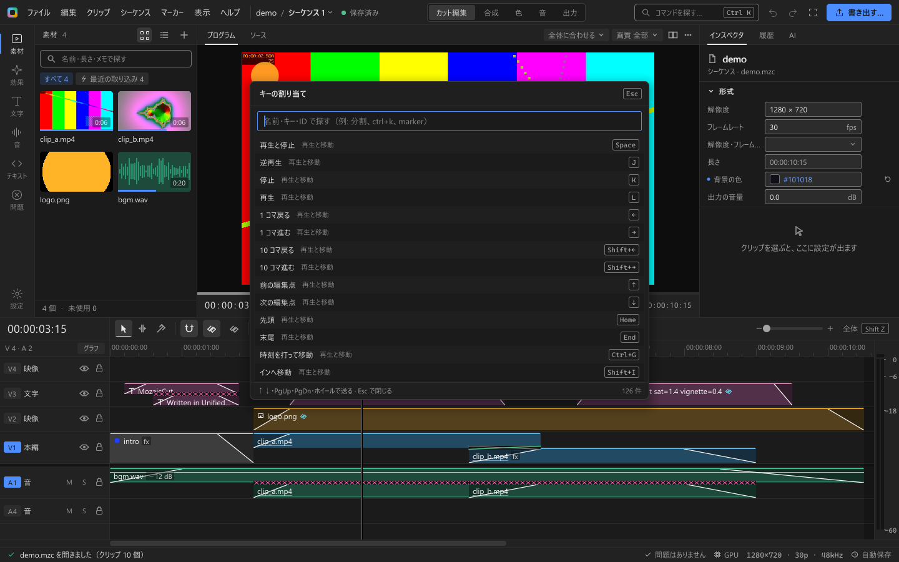

# 2. 編集の基本

[目次](README.md) ／ 前: [1. はじめに](01-getting-started.md) ／ 次: [3. テキストで編集する](03-text.md)

MozaicCut の編集は、どれも **同じ操作**（`move`、`trim`、`split`、`delete` など）を通ります。編集画面でクリップをドラッグしても、`mozcut op` で打っても、AI のエージェントが MCP で呼んでも、`.mzc` の該当する行だけが同じように書き換わります。

この章の例は、[1.5](01-getting-started.md#15-プロジェクトを作る) で作った `first.mzc` に続けて実行したものです。

## 2.1 編集画面とコマンドの使い分け

| したいこと | 編集画面 | コマンド（`mozcut op`） |
| --- | --- | --- |
| 素材を足す | 準備中 | `add` |
| 動かす | クリップをドラッグ | `move` |
| 始まり・終わりを詰める／伸ばす | クリップの左端・右端をドラッグ | `trim` |
| 分ける | 再生位置に合わせて S | `split` |
| 消す | Delete / Backspace | `delete` |
| 範囲を切り取って詰める | 準備中 | `cut` |
| 値（効果・文字・位置）を変える | 準備中 | `set` / `unset` |
| 取り消す | Ctrl+Z / Ctrl+Y | なし（[2.8](#28-取り消しとやり直し)） |

## 2.2 クリップの指し方

コマンドでクリップを指すには、3 通りの書き方があります。

| 書き方 | 意味 | 向き・不向き |
| --- | --- | --- |
| `main` | ID（行に `id=main` と書いたもの） | **いちばん安定。** 行を足したり消したりしてもずれない |
| `#1` | 0 から数えた番号（`show` の左の列） | 行が増えるとずれる |
| `@5` | `.mzc` の行番号（`show` の「行」の列） | 行が増えるとずれる |

ID のないクリップを何度も触るときは、先に `mozcut op first.mzc set @5 id=main` のように ID を付けると楽です。

操作は、試すだけの `--dry-run` を付けると、書き換わる行の前（`-`）と後（`+`）を見せて、保存しません。慣れないうちは、まず `--dry-run` で確かめてから外してください。

## 2.3 素材を足す

編集画面からクリップを足す機能（メディアプール、ドラッグ＆ドロップ）は **準備中** です。いまは `op add` か、`.mzc` に 1 行書いて足します。

```console
$ mozcut op first.mzc add video "media/clip_a.mp4" id=ending in=2 out=4 after main
ending（video）を main の次の行に足しました（8.5 秒〜10.5 秒、映像トラック 0）
  + 6: video "media/clip_a.mp4" id=ending in=2 out=4
保存しました（first.mzc）
```

- `after main` を付けると main の次の行に入ります。省くとファイルの最後です。
- `at=` を書かない映像は、同じトラックの前の行のクリップの後ろに並びます（上の例では main の終わりの 8.5 秒から）。
- `id=` を書かなければ、`image1`、`text1` のような ID が付きます。

```console
$ mozcut op first.mzc add image "media/logo.png" at=0 dur=8.5 x=24 y=24 w=96
image1（image）をファイルの最後に足しました（0 秒〜8.5 秒、映像トラック 1）
  + 9: image "media/logo.png" id=image1 at=0 dur=8.5 x=24 y=24 w=96
保存しました（first.mzc）
```

足した後のタイムライン:

```console
$ mozcut show first.mzc --width 80
first.mzc
1280x720  30fps  48000Hz  0:10.500  クリップ 6
    0:00   0:01   0:02   0:03   0:04    0:05   0:06   0:07   0:08    0:09   0:10
    +------+------+------+------+-------+------+------+------+-------+------+---
V2     [title        ]
V1  [image1                                                     ]
V0  [opening            ]                                        [ending       ]
                      [main                                     ]
A0  [bgm                                                        ]
```

足せる種類は `video`（動画）、`image`（静止画）、`text`（文字）、`color`（単色）、`audio`（音）です（[3.2](03-text.md#32-行の種類)）。

## 2.4 並べる（動かす）

**編集画面:** クリップをつかんで左右にドラッグします。端は、ほかのクリップの端・再生位置・0 に吸い付き、コマの境目に揃います。ドラッグの途中で Esc を押すとやめられます。

**コマンド:** `move <クリップ> <時刻>` です。時刻は秒（`5.5`）か `分:秒`（`1:02.5`）です。

```console
$ mozcut op first.mzc move title 1 --dry-run
title を 0.5 秒から 1 秒に動かしました
  - 7: text "はじめての動画" id=title at=0.5 dur=2 size=80 outline=000000
  + 7: text "はじめての動画" id=title at=1 dur=2 size=80 outline=000000
保存していません（--dry-run）
```

ほかのクリップを基準にして置くこともできます（参照）。参照で置いたクリップは、基準のクリップを動かすと一緒に動きます。

```console
$ mozcut op first.mzc move title opening.start+1 --dry-run
title を 0.5 秒から opening.start+1（1 秒）に動かしました
  - 7: text "はじめての動画" id=title at=0.5 dur=2 size=80 outline=000000
  + 7: text "はじめての動画" id=title at=opening.start+1 dur=2 size=80 outline=000000
保存していません（--dry-run）
```

書ける参照は `opening.start`、`opening.end`、`opening.start+1.5`、`opening.end-0.5`、`after:opening`（`opening.end` と同じ）です。

トラックを変える（上下に動かす）操作は、編集画面では **準備中** です。`mozcut op first.mzc set title track=3` のように `track=` を変えてください。

## 2.5 詰める・伸ばす（トリム）

**編集画面:** クリップの左端・右端をドラッグします。

**コマンド:** `trim <クリップ> start|end <時刻>` です。時刻は **タイムライン上の時刻** です（素材の中の時刻ではありません）。

```console
$ mozcut op first.mzc trim main end 7
main の終わりを 8.5 秒から 7 秒にしました（長さ 4.5 秒）。ほかに 1 個のクリップの時刻が変わりました: ending 8.5→7 秒
  - 5: video "media/clip_b.mp4" id=main xfade=0.5
  + 5: video "media/clip_b.mp4" id=main xfade=0.5 dur=4.5
保存しました（first.mzc）
```

main の後ろに `at=` なしで並んでいた ending も、一緒に前へ詰まりました。操作でほかのクリップの時刻が変わったときは、このように「ほかに N 個のクリップの時刻が変わりました」と出ます。

始まりを詰めると、素材の使い始め（`in=`）も合わせて変わります。

```console
$ mozcut op first.mzc trim opening start 0.5 --dry-run
opening の始まりを 0 秒から 0.5 秒にしました（長さ 2.5 秒）
  - 4: video "media/clip_a.mp4" id=opening in=1 out=4
  + 4: video "media/clip_a.mp4" id=opening in=1.5 out=4 at=0.5
保存していません（--dry-run）
```

## 2.6 分ける

**編集画面:** クリップをクリックして選び、再生位置（赤い線）を分けたい所に合わせて S を押します。

**コマンド:** `split <クリップ> <時刻>` です。後半は次の行に入り、ID は `<元の ID>_2` になります。

```console
$ mozcut op first.mzc split main 5
main を 5 秒で分けました（後半は main_2）
  - 5: video "media/clip_b.mp4" id=main xfade=0.5 dur=4.5
  + 5: video "media/clip_b.mp4" id=main xfade=0.5 dur=2.5
  + 6: video "media/clip_b.mp4" id=main_2 dur=2 at=main.end in=2.5
保存しました（first.mzc）
```

### 速さを変える

**編集画面:** 映像か音のクリップを選び、クリップのメニューの［速度と長さ…］（Ctrl+R。右クリックの［速度］も同じ）で % を打って Enter を押します。
200 で 2 倍速、50 で半分の速さです。使う素材の範囲はそのままで、長さが変わります（200% なら半分の長さ）。インスペクタの「速度」でも変えられます。
音も同じ速さで鳴り、高さも変わります（テープを速く回したときと同じ）。

**コマンド:** `set <クリップ> speed=<倍率>` です。行には `speed=2` のように書きます。`dur=` はタイムラインの長さで、使う素材は `dur × speed` 秒です。
途中で速さを変える・止める・逆に戻すときは `timeremap`（キーフレーム）を使います。両方を書くと `timeremap` が使われます。

### 映像と音をリンクする

映像の行と、別に置いた音の行（同じ素材の音・ナレーションなど）を組にすると、一緒に選び・動かし・消し、端のそろった相手は一緒にトリムします。
**編集画面:** 両方を選んで（Ctrl+クリックで足す）クリップのメニューの［リンク ／ リンクを解除］（Ctrl+L）。もう一度押すと解けます。
タイムラインの左上の［リンクした選択］を切ると、組でも片方だけを選べます。
**コマンド:** 同じ名前の `link=` を書きます（`set clip_a link=L1`、`set voice link=L1`）。

### マッチフレーム

タイムラインの再生位置にあるクリップの素材を、ソースのモニターで同じコマから開きます（F。クリップのメニューの［マッチフレーム］）。
選んだクリップがあればそれを、なければいちばん上の映像を開きます。

## 2.7 消す

**編集画面:** クリップを選んで Delete か Backspace を押します。

**コマンド:** `delete <クリップ>` です。行は消さずに、先頭に `# ` を付けて注釈にします（あとで `# ` を外せば元に戻せます）。

```console
$ mozcut op first.mzc delete main_2
main_2（5 秒〜7 秒）を消しました（行を注釈にしました）。ほかに 1 個のクリップの時刻が変わりました: ending 7→5 秒
  - 6: video "media/clip_b.mp4" id=main_2 dur=2 at=main.end in=2.5
  + 6: # video "media/clip_b.mp4" id=main_2 dur=2 at=main.end in=2.5
保存しました（first.mzc）
```

- `at=` のない後ろのクリップは、前へ詰まります（上の例の ending）。隙間を残したいときは、先に後ろのクリップを `move` で秒の数に置いてから消します。
- ほかのクリップの `at=` から参照されているクリップは、そのままでは消せません（`referenced`）。`delete <クリップ> fix-refs` なら、参照している側の `at=` を今の秒に書き換えてから消します。

```console
$ mozcut op demo/demo.mzc delete clip_a
エラー[referenced]: clip_a は pip, logo, caption_a の at= から参照されています
  ヒント: 参照しているクリップの at= を今の秒に書き換えてから消すなら delete clip_a fix-refs と書きます。参照しているクリップも消すなら、先にそれらを delete します（move <クリップ> <秒> で at= を秒にしてもよい）
何も書き換えていません
```

**範囲を切り取る:** 「最初の 1 秒を切る」のように、時刻の範囲を全トラックから切り取って後ろを詰めるのは `cut <開始> <終わり>` です（編集画面では準備中）。

```console
$ mozcut op first.mzc cut 0 1 --dry-run
0 秒〜1 秒（1 秒）を切り取って後ろを詰めました（消した 0 個、短くした 4 個）。ほかに 6 個のクリップの時刻が変わりました: opening の終わり 3→2 秒、main 2.5→1.5 秒、ending 5→4 秒、title 0.5→0 秒、bgm の終わり 8.5→7.5 秒、image1 の終わり 8.5→7.5 秒
  - 4: video "media/clip_a.mp4" id=opening in=1 out=4
  + 4: video "media/clip_a.mp4" id=opening in=2 out=4
  - 8: text "はじめての動画" id=title at=0.5 dur=2 size=80 outline=000000
  + 8: text "はじめての動画" id=title at=0 dur=1.5 size=80 outline=000000
  - 9: audio "media/bgm.wav" id=bgm dur=8.5 volume=0.3 fadeout=1
  + 9: audio "media/bgm.wav" id=bgm dur=7.5 volume=0.3 fadeout=1 in=1
  - 10: image "media/logo.png" id=image1 at=0 dur=8.5 x=24 y=24 w=96
  + 10: image "media/logo.png" id=image1 at=0 dur=7.5 x=24 y=24 w=96
保存していません（--dry-run）
```

## 2.8 取り消しとやり直し

**編集画面:** Ctrl+Z で取り消し、Ctrl+Y（または Ctrl+Shift+Z）でやり直しです。取り消すとファイルもすぐに保存し直し、下の帯に「取り消し: clip_b を 7 秒で分けました（後半は clip_b_2）（保存しました）」のように出ます。

- 取り消せるのは、**その編集画面で行った操作** だけです。編集画面を閉じると、取り消しの履歴はなくなります。
- テキストエディタやコマンド・AI（MCP）で書き換えた分は、編集画面が読み直したときに「ファイルが外で書き換えられました」（Claude Code なら「Claude Code: …」）の 1 つとして取り消しに入ります。Ctrl+Z で、その書き換えの前に戻せます。
- 取り消しは、ファイル全体をその操作の前の中身に戻します。

**コマンド:** `mozcut op` には取り消しがありません。代わりに次の手があります。

- 先に `--dry-run` で書き換わる行を確かめる。
- `delete` は行を注釈にするだけなので、`# ` を外せば戻せる。
- `.mzc` はテキストなので、git などで版を残しておけば、いつでも前の版に戻せる。

準備中: 履歴の一覧（どの操作をだれ〈人・AI〉がしたか）と、そこから選んで戻すこと。

## 2.9 失敗したとき

操作が誤りを増やすときは、**何も書き換えずに止めます**。編集画面では下の帯に赤で `[原因コード] 理由 ／ ヒント: ...` と出ます。コマンドでは次のように出ます（終了コード 1）。

```console
$ mozcut op demo/demo.mzc set pip blur=999
エラー[out-of-range]: この操作で誤りが増えるため、適用しませんでした（12 行目: 'blur' の値 999 は範囲の外です）
  ヒント: 0〜64 の範囲で書きます
何も書き換えていません
```

名前を打ち間違えたときは、近いものを推します。

```console
$ mozcut op demo/demo.mzc mvoe clip_b 3
エラー[unknown-op]: 'mvoe' という操作はありません
  ヒント: 'move' のことですか？ 操作は move / trim / split / delete / cut / set / unset / renamekey / add / rename のどれかです（書き方: node tools/mozcut.mjs schema）
何も書き換えていません
```

## 2.10 いくつもの操作をまとめる

操作を 1 行に 1 つ書いて `--file` で渡すと、まとめて適用します（次の例は、[1.5](01-getting-started.md#15-プロジェクトを作る) で書いたままの `first.mzc` に対して実行したものです）。**1 つでも失敗すれば、何も書き換えません。** `-` なら標準入力から読みます。

```console
$ mozcut op first.mzc --file - <<'EOF'
set main sepia=0.6 vignette=0.5
set title blur=1
EOF
main の値を変えました: sepia 0.6（新規）、vignette 0.5（新規）
  - 5: video "media/clip_b.mp4" id=main xfade=0.5
  + 5: video "media/clip_b.mp4" id=main xfade=0.5 sepia=0.6 vignette=0.5
title の値を変えました: blur 1（新規）
  - 6: text "はじめての動画" id=title at=0.5 dur=2 size=80 outline=000000
  + 6: text "はじめての動画" id=title at=0.5 dur=2 size=80 outline=000000 blur=1
保存しました（first.mzc）
```

## 2.11 キーの一覧（編集画面）

編集画面で F1 か ? を押すと、同じ一覧が重ねて出ます（Esc か F1 でしまう）。



| キー・マウス | 動作 |
| --- | --- |
| クリップをクリック | 選ぶ（プレビューの右下に ID・種類・時間・行の中身が出る） |
| クリップをドラッグ | 動かす（`move`） |
| クリップの左端・右端をドラッグ | 始まり・終わりを詰める／伸ばす（`trim`） |
| 目盛りや空いた所をクリック・ドラッグ | 再生位置を動かす |
| Space | 再生・停止（音は出ません。準備中） |
| L / J / K | 順再生 / 逆再生 / 停止。L・J を続けて押すと 2 倍 → 4 倍 |
| ← / → | 1 コマ戻る・進む（Shift で 1 秒） |
| Home / End | 先頭へ・最後へ |
| S | 選んだクリップを再生位置で分ける（`split`） |
| Delete / Backspace | 選んだクリップを消す（`delete`） |
| Ctrl+Z / Ctrl+Y（Ctrl+Shift+Z） | 取り消し・やり直し |
| ホイール | タイムラインの拡大・縮小（Shift+ホイールか横のホイールで左右に動かす） |
| F | タイムラインを全体が見える大きさにする |
| Esc | ドラッグをやめる・選ぶのをやめる・キーの一覧をしまう |
| F1 / ? | キーの一覧を出す・しまう |
| Ctrl+Q / Ctrl+W | 閉じる |

準備中: 編集ツール（ブレード、リップル、スリップなど）、3 点編集、マーカー、キーの割り当ての変更。
