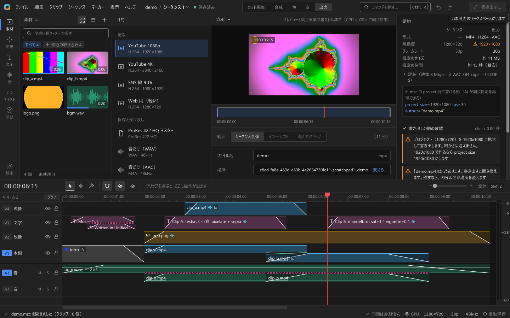

# 5. 書き出す

[目次](README.md) ／ 前: [4. 効果を掛ける](04-effects.md) ／ 次: [6. AI と一緒に使う（MCP）](06-ai.md)

書き出しには 2 つの道があります。

- **編集画面の［出力］**（5.1）: 目的（YouTube・SNS・保存用・音だけ など）を選んで書き出します。ふだんはこちらです。
- **コマンド**（5.2〜5.4）: `mozcut preview` で 1 コマを画像に、`mozcut render` でプロジェクトのままの MP4 にします。決まった手順でくり返し書き出すときや、AI のエージェントから使うときに向きます。

どちらも、誤りのあるプロジェクトは書き出せません。先に誤りを直してください（[7. 困ったとき](07-troubleshooting.md)）。

動画の読み書きには、MozaicCut の中に組み込んだ FFmpeg を使います。配布の形（`MozaicCut.exe`）でも、FFmpeg のライブラリを見つけてビルドした版でも、ffmpeg のコマンドは要りません。組み込みのない版の動きは [5.6](#56-ffmpeg-の組み込みのない版) にまとめました。

## 5.1 編集画面の［出力］から書き出す

右上の青い［**書き出す…**］を押すか **Ctrl+M** を押すと、上の帯のワークスペースが［**出力**］に変わります。上の帯の［出力］を押しても同じです。手順だけを知りたいときは [0.9 書き出す](00-beginner.md#09-書き出すmp4-を作る) を見てください。



画面は 3 つの列に分かれます。

| 列 | 中身 |
| --- | --- |
| 左「目的」 | プリセットの一覧（「配る」と「保存と受け渡し」の 2 つの組） |
| 真ん中 | プレビュー、範囲、ファイル名、場所 |
| 右 | 要約（いまのシーケンスと書き出す形の比べ）、書き出しの前の確認、［書き出す］［待ち行列に足す］、待ち行列 |

### 目的（プリセット）

| プリセット | 形式 | 大きさ・コマ | 音 |
| --- | --- | --- | --- |
| YouTube 1080p | MP4（H.264、8 Mbps。31 コマ/秒以上は 12 Mbps） | 1920×1080、60 コマ/秒まで | AAC 384 kbps、-14 LUFS |
| YouTube 4K | MP4（H.264、45 Mbps。31 コマ/秒以上は 68 Mbps） | 3840×2160、60 コマ/秒まで | AAC 384 kbps、-14 LUFS |
| SNS 縦 9:16 | MP4（H.264、10 Mbps） | 1080×1920、30 コマ/秒まで | AAC 192 kbps、-14 LUFS |
| Web 用（軽い） | MP4（H.264、品質 26、上限 2.5 Mbps） | 1280×720、30 コマ/秒まで | AAC 128 kbps、-16 LUFS |
| ProRes 422 HQ マスター | MOV（ProRes 422 HQ） | プロジェクトのまま | PCM 24 ビット（音量は変えない） |
| 音だけ（WAV） | WAV | — | PCM 24 ビット、48 kHz ステレオ（音量は変えない） |
| 音だけ（AAC） | M4A | — | AAC 256 kbps、-16 LUFS |

- 開いたときは、プロジェクトに合うものを選んであります（縦の画面なら SNS 縦 9:16、高さ 2160 以上なら YouTube 4K、ほかは YouTube 1080p）。
- **大きさ**: プロジェクトとプリセットの大きさが違うときは、縦横の比を保って収め、余りは黒い帯にします。
- **コマの速さ**: プロジェクトのままです。プリセットの上限を超えるときは、ちょうど 1/2・1/3 … に間引きます（60 → 30 など）。
- **音の大きさ**: LUFS の目標があるプリセットは、先に全体の音の大きさを測り、目標に合わせて全体に 1 つの倍率を掛けます（ピークは -1 dBTP を超えない所まで）。
- ProRes の入れ物は 10 ビット 4:2:2 ですが、いまの合成は 8 ビット 4:2:0 なので、色の細かさはそれと同じです。
- H.264 の圧縮には、使える GPU の符号器（NVIDIA・AMD・Intel）か、なければ OS の符号器（Windows では Media Foundation）を使います。

### 範囲・ファイル名・場所

- **範囲**: ［シーケンス全体］［イン〜アウト］（I と O のキーで付けた範囲）［選んだクリップ］から選びます。［出力］を開くたびに、編集画面のイン・アウトと選んだクリップを写します。プレビューの下の帯をなぞると、範囲の中を確かめられます。
- **ファイル名**: 初めは project の行の `output=` の名前、書いていなければ `.mzc` の名前です。拡張子（`.mp4` など）はプリセットで決まります。
- **場所**: 初めは `output=` に書いたフォルダ、書いていなければ `.mzc` のあるフォルダです。［変える…］で選べます。まだないフォルダは、書き出すときに作ります。

### 書き出しの前の確認

右の「書き出しの前の確認」に、書き出す前に知っておくことが出ます。⚠ は注意（書き出せます）、エラーは直すまで［書き出す］が押せません（ボタンを指すと、押せない理由が出ます）。

| 出るもの | 意味 | ボタン |
| --- | --- | --- |
| `.mzc` の誤り（素材が見つからない など） | `mozcut check` と同じ誤り。直すまで書き出せない | ［場所を指定する］（素材が見つからないとき）、［そのクリップへ移る］ |
| プロジェクト（1280x720）を 1920x1080 に拡大して書き出します | プロジェクトより大きいプリセット | 合うプリセットがあれば［〜にする］ |
| プロジェクトは縦の画面ですが、〜は横の画面です | 縦と横が違う。大きな黒い帯が付く | ［シーケンスの設定を開く］、［〜にする］ |
| 縦横比が違います | 黒い帯が付く | — |
| コマを間引いて書き出します | プリセットの上限よりコマの速さが大きい | — |
| 長さが〜の目安より長いです | SNS 縦 9:16 は 180 秒が目安 | — |
| プロジェクトに音がないので、無音の音声を入れて書き出します | 音のクリップがない（音だけのプリセットではエラー） | — |
| 「demo.mp4」はもうあります。書き出すと置き換えます | 同じ名前のファイルがある | 残すなら、ファイル名か場所を変える |
| 書き出す範囲が空です | イン・アウトや選んだクリップがない範囲 | 範囲を［シーケンス全体］にする |

### 書き出す・待ち行列

- ［**書き出す**］で始まります。書き出しの間も編集画面は使えます（そのぶん画面の動きは遅くなります）。進み具合は、どのワークスペースにいても下の状態の帯に出ます（押すと［出力］に戻ります）。終わると「書き出しました: <場所>」と出ます。
- ［**待ち行列に足す**］で、設定を変えながら書き出すものを並べられます。［書き出す］を押すと、並べた順に書き出します。
- 待ち行列の仕事は、書いている途中なら × で取りやめられます。終わったものは［場所をコピー］（書いたファイルの場所をクリップボードに写す）と［範囲を再生］、失敗したものは［そのクリップへ移る］［詳細をコピーする］［やり直す］が使えます。
- 書き出しは、いったん `<プロジェクト名>.cache/wsx/` に書き、書き終えてから選んだ場所に写します。途中で取りやめても、前からあった同じ名前のファイルは壊れません。
- 書き出すのは、保存されている `.mzc` です（編集画面は操作のたびに `.mzc` を書くので、画面の中身と同じです）。

## 5.2 1 コマを画像にする（preview）

```console
$ mozcut preview first.mzc 1.5
mozcut: preview.png に書きました（0:01.500）
```

- 既定の書き先は、`.mzc` と同じフォルダの `preview.png` です。`-o shot.png` で変えられます（`.bmp` も書けます）。
- 時刻は秒（`1.5`）か `分:秒`（`1:02.5`）です。
- PNG にするときだけ、最後に ffmpeg のコマンドで BMP から変換します。ffmpeg のコマンドがなければ `-o shot.bmp` のように BMP で書いてください。
- 全体の長さより後ろの時刻は、警告を出して背景だけを描きます。

```console
$ mozcut preview first.mzc 20
mozcut: 警告: 0:20.000 は全体の長さ（0:10.500）より後ろです（背景だけが描かれます）
mozcut: preview.png に書きました（0:20.000）
```

動画を全部書き出すより速いので、見た目の確かめには `preview` で十分なことが多いです。

## 5.3 動画を書き出す（render）

```console
$ mozcut render first.mzc
符号器: 映像 h264_nvenc（4.2 Mbps）、音 aac
映像 1/315 コマ（毎秒 0.7 コマ）
映像 147/315 コマ（毎秒 62 コマ）
映像 295/315 コマ（毎秒 87.5 コマ）
映像 315/315 コマ（毎秒 88.6 コマ）
C:\Users\you\Videos\myvideo\demo.mp4 に書き出しました（0:10.500、映像 315 コマ、音 504000 標本）
```

- `first.mzc` は `demo/demo.mzc` を写したもので、project の行に `output=demo.mp4` と書いてあります。
- 1 行目は、使う符号器です。`h264_nvenc` は NVIDIA の GPU の符号器で、パソコンによって違う名前が出ます。
- 書き出し先は project の行の `output=`（`.mzc` のフォルダから）です。省くと `out.mp4` です。
- `-o part.mp4` で書き出し先を変えられます（このときは、コマンドを実行したフォルダからのパスです）。
- **同じ名前のファイルがあれば、確かめずに上書きします。**
- 書き出す形式は、プロジェクトのままの大きさ・コマの速さの MP4（H.264、yuv420p、BT.709 と AAC 192 kbps）だけです。ほかの形式や大きさは、編集画面の［出力］（5.1）で書き出します。音の大きさ（LUFS）は揃えません。

上の例で書き出した MP4 を ffprobe で見ると、次のとおりです（ffprobe は ffmpeg に付いてくるコマンドで、MozaicCut には要りません）。

```console
$ ffprobe -v error -show_entries stream=codec_name,width,height,pix_fmt,color_space,r_frame_rate,sample_rate -show_entries format=duration -of compact demo.mp4
stream|codec_name=h264|width=1280|height=720|pix_fmt=yuv420p|color_space=bt709|r_frame_rate=30/1
stream|codec_name=aac|sample_rate=48000|r_frame_rate=0/0
format|duration=10.500000
```

### 一部だけ書き出す

```console
$ mozcut render first.mzc --from 2 --to 3 -o part.mp4
符号器: 映像 h264_nvenc（4.2 Mbps）、音 aac
映像 1/30 コマ（毎秒 0.5 コマ）
映像 30/30 コマ（毎秒 14.6 コマ）
C:\Users\you\Videos\myvideo\part.mp4 に書き出しました（0:01.000、映像 30 コマ、音 48000 標本）
```

範囲が空のときや、時刻が読めないときは、何もせずに止まります（終了コード 2）。

```console
$ mozcut render first.mzc --from 5 --to 3
mozcut: 範囲が空です（--from 5 --to 3）。--to は --from より後ろにします
$ mozcut render first.mzc --from 20
mozcut: 範囲が空です（--from 20 は全体の長さ 0:10.500 より後ろです）
$ mozcut render first.mzc --to x
mozcut: --to の値 'x' は時刻として読めません（3.5 や 1:02.5 のように書きます）
```

### 画質

project の行で決めます。

| key | 意味 | 既定 |
| --- | --- | --- |
| `crf` | 画質の目安（0〜51。小さいほど高画質で、ファイルが大きい）。組み込みの FFmpeg では、大きさとコマの速さからビット毎秒を決めるのに使います（`crf` 18 の 1080p 30 コマ/秒で約 12 Mbps、6 上がるごとに半分） | 20 |
| `preset` | x264 の速さ（`ultrafast` 〜 `placebo`）。ffmpeg のコマンドで書き出すとき（5.6）だけ使います | `medium` |
| `size` / `fps` / `rate` | 画面の大きさ・1 秒のコマ数・音の標本化周波数 | 1280x720 / 30 / 48000 |

```sh
project size=1920x1080 fps=30 output=final.mp4 crf=18
```

このプロジェクトを書き出すと、1 行目は `符号器: 映像 h264_nvenc（12 Mbps）、音 aac` になります。

なお、書き出しの画面の「プリセット」（5.1 の目的）と、project の行の `preset=`（x264 の速さ）は別のものです。

## 5.4 配布の形の mozcut.exe で書き出す

配布の形（`dist/MozaicCut/`）には、編集画面の `MozaicCut.exe` のほかに、コマンドの `mozcut.exe` が入っています。node がなくても、これだけで書き出せます。

```console
> mozcut.exe render first.mzc --out first.mp4
> mozcut.exe render first.mzc 2 3 --out part.mp4
> mozcut.exe preview first.mzc 1.5 shot.bmp
```

- `render` には `--out` を必ず付けます。付けないと MP4 は書かず、キャッシュに中間のファイル（`out.y4m` / `out.pcm`）を書くだけです。
- `render` の範囲は、`--from` / `--to` ではなく、ファイルの後ろに秒を 2 つ並べます（始まりと終わり）。
- `preview` は BMP だけを書きます（名前を `.png` にしても中身は BMP です）。
- 使い方の一覧は `mozcut.exe`（引数なし）で出ます。

## 5.5 キャッシュ（<プロジェクト名>.cache）

`mozcut` のコマンドや編集画面は、`.mzc` の隣に `<プロジェクト名>.cache/` を作ります。組み込みの FFmpeg のある版では、素材をその場で読むので、ここには `preview` の途中の画像や、［出力］の書きかけのファイル（`wsx/`）が入るだけです。

例外は `mozcut motion`（点を追う）と、組み込みのない版（5.6）です。この 2 つは素材を ffmpeg のコマンドで生の映像と音に展開してここに残すので、ディスクを多く使います（720p 30 コマ/秒で 1 秒あたり約 40 MB）。

キャッシュは消しても構いません。要るときに作り直します。

## 5.6 FFmpeg の組み込みのない版

FFmpeg のライブラリが見つからないままビルドすると、組み込みのない版になります（`node tools/mozcut.mjs build` がそう知らせます。配布の形は作れません）。この版では次のように動きます。

- `render` / `preview` は、まず素材を ffmpeg のコマンドで展開して（`mozcut: ffmpeg で素材を 3 件展開しています...`）、キャッシュに残します。2 回目からは、クリップの設定や素材が変わらなければ使い回します。`-j N` は、展開で ffmpeg を同時に動かす数です。
- `render` は、1 コマずつ合成した中間のファイル（`out.y4m` / `out.pcm`）を ffmpeg のコマンドで MP4（libx264、`crf` と `preset` を使う、AAC 192 kbps）にし、済むと中間のファイルを消します。libx264 の入った ffmpeg が要ります（[7.2](07-troubleshooting.md#72-書き出しで止まる)）。
- 編集画面の［出力］は、`node tools/mozcut.mjs edit` から開いたときだけ（書き出しの係 `tools/ws-export-runner.mjs` が ffmpeg のコマンドで）書き出せます。そうでなければ「この形式（〜）は、この版の MozaicCut だけでは書き出せません」と出ます。
- ffmpeg と ffprobe は PATH から探します。ほかの場所なら、環境変数 `FFMPEG` / `FFPROBE` に設定します。

## 5.7 準備中

- HEVC・VP9、画像の連番、HDR の書き出し
- 10 ビットや 4:4:4 の合成（ProRes でも、いまは 8 ビット 4:2:0 の細かさです）
- 自分のプリセットの保存（「目的」の一覧に組はありますが、まだ足せません）
